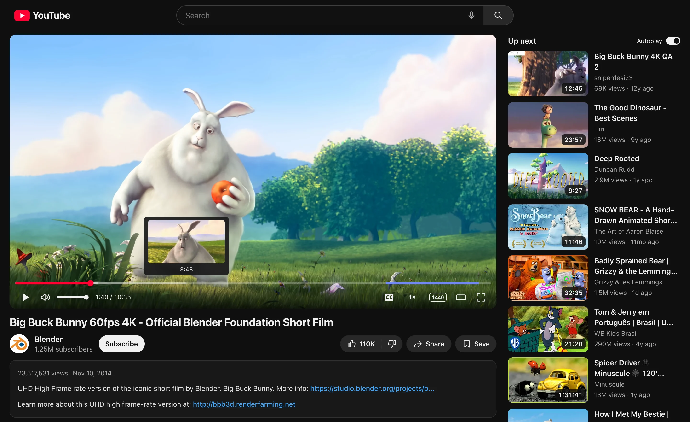
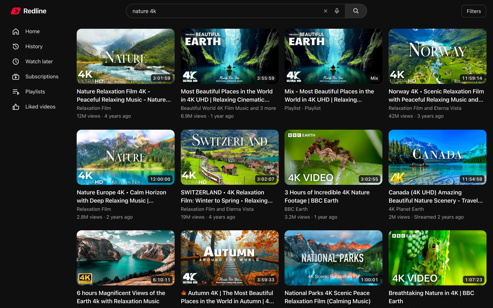
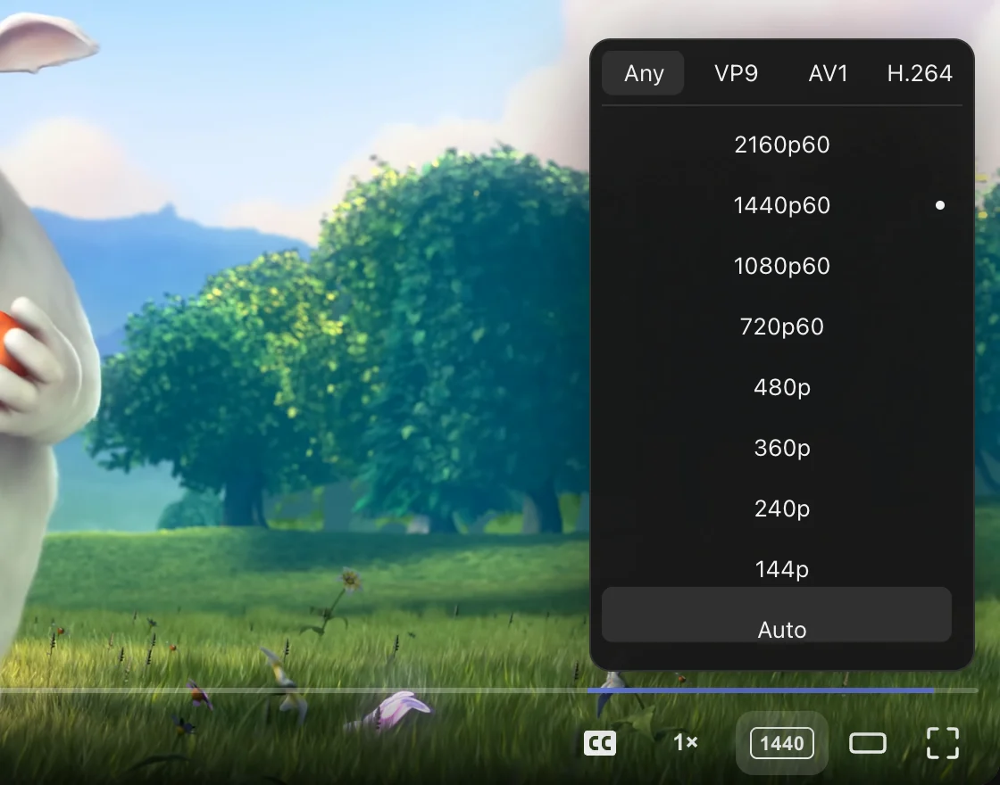
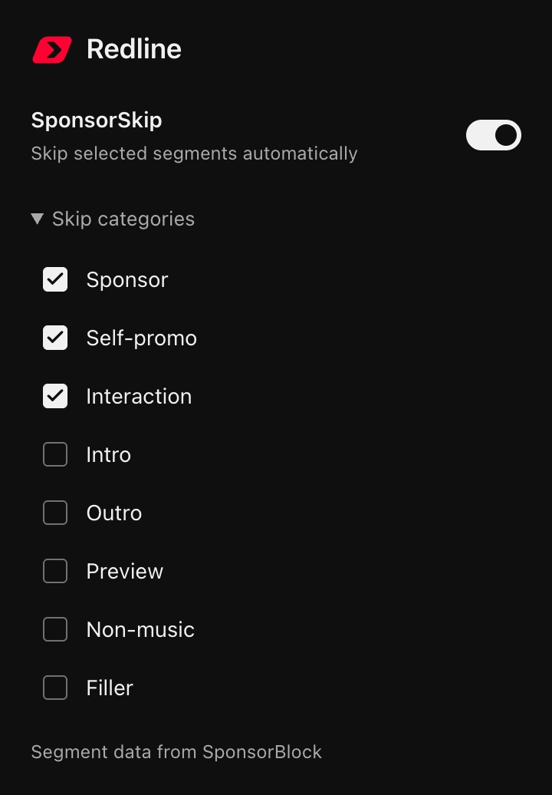
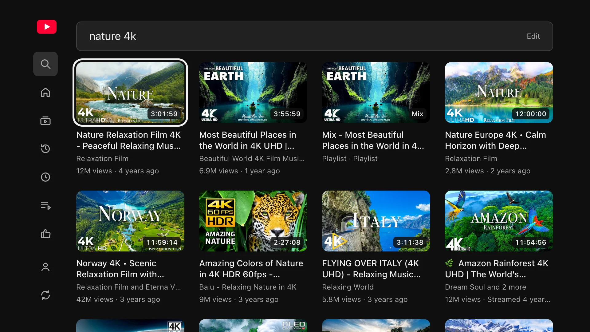
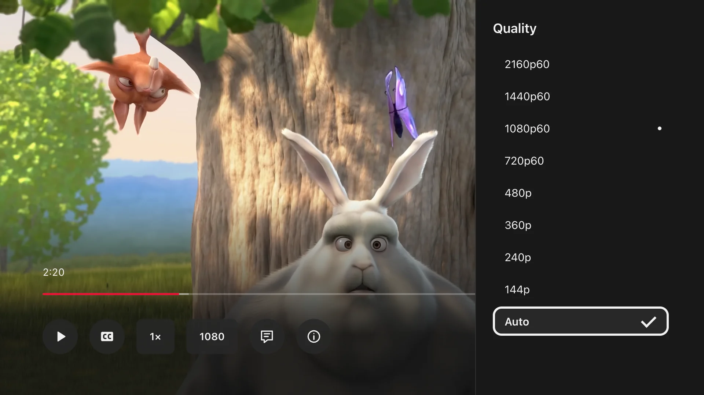

<p align="center">
  
</p>

<h1 align="center">Redline</h1>

<p align="center">
  <b>A fast, ad-free client for YouTube</b><br>
  For Chrome, Brave, Edge and other Chromium browsers, and for Google TV / Android TV.
</p>

<p align="center">
  <a href="#install">Install</a> ·
  <a href="#screenshots">Screenshots</a> ·
  <a href="#privacy">Privacy</a> ·
  <a href="#faq">FAQ</a>
</p>

Redline replaces YouTube's web app with its own: the same videos, your same account, subscriptions, history
and playlists, but pages that appear at once, a video player of its own and no ads. It runs right at
www.youtube.com as a browser extension, reads YouTube's own data, and draws everything itself. It has no
server and no account of its own, and it is free and open source.

<p align="center">
  
</p>

> **Experimental.** Redline uses unofficial YouTube interfaces that can change at any time. When something
> breaks, the player tells you why and offers **Open on YouTube** for that video.

## Why Redline

Measured on real youtube.com, signed out, in November 2026 (medians; methods and every number in
[docs/architecture.md](docs/architecture.md), "Speed").

- **Home reloads in about 0.2–0.3 s.** Redline asks YouTube for your next Home ahead of time, so a reload shows
  YouTube's fresh Home in 0.19–0.32 s, where YouTube's own page takes 1.1–1.4 s. With Home open in another tab, a
  new tab shows it in 0.19 s (YouTube: 1.4 s).
- **Video in about 60 ms.** Rest the pointer on a video for a moment and click: its first frame is on screen in
  about 60 ms.
- **About 9 ms of its own work to start.** When a page opens, almost all the waiting is YouTube's server.
- **Quality changes at once.** Pick another quality and it shows in about 0.1 s, not at the next piece of the video.
- **Lighter on your connection.** The watch page asks YouTube only for what it shows: 28 KB instead of 62 KB per
  video. Thumbnails come in the smallest size that is still sharp on your screen.
- **Quick on a TV.** A press on the remote moves the focus in about 50 ms, even at a TV's slower processor.

## Features

| Feature | What you get |
|---|---|
| **Its own video player** | Up to 4K and 60 fps (VP9, AV1, H.264), speed 0.25–2.5×, chapters, frame previews when you hover the seek bar, captions you can move and resize, live streams, resume where you left off. |
| **No ads** | No video ads, no banners, no Premium or membership upsells. Shorts only if you want them. |
| **SponsorSkip built in** | Skips sponsor segments and other categories you choose, switched in the toolbar popup. Segment data from [SponsorBlock](https://sponsor.ajay.app/). |
| **Home exactly as YouTube's** | Your Home is YouTube's own answer, same videos and order, with your own topics next to YouTube's chips. |
| **Recovers by itself** | A media error or an expired link mid-video is repaired in place, without reloading the page; if that fails, it says why. |
| **Watch later, newest first** | Your latest saves on top; removing one is instant. |
| **Filters** | Minimum length, show or hide Music and Live, Home by popularity, playlists only; hide videos that link to websites you block. |
| **Search** | Your recent searches and YouTube's suggestions in one list, YouTube's search filters, results ready as you pause typing. |
| **Voice search** | Optional, with your own [Deepgram](https://deepgram.com/) key: hover the mic, or hold ⌥ Option / Alt, and speak. |
| **Keyboard shortcuts** | `?` lists them: `/` search, `g h` Home, `g s` Subscriptions, and more. |
| **Everything you use on YouTube** | Subscriptions, History, Playlists, Liked videos, channels, comments with replies, like, subscribe, save, share. |
| **Redline for TV** | The same client on Google TV / Android TV: a 10-foot interface for the remote, an on-screen keyboard, sign-in with your phone, updates by itself. |
| **Private by design** | No server, no analytics, no telemetry. Settings stay in your browser. See [Privacy](#privacy). |

## Screenshots

<table>
  <tr>
    <td colspan="2"></td>
  </tr>
  <tr>
    <td width="68%"></td>
    <td></td>
  </tr>
</table>

<table>
  <tr>
    <td width="50%"></td>
    <td width="50%"></td>
  </tr>
</table>

<sub>Top: search, the player's quality menu and the toolbar popup. Bottom: Redline for TV (1920×1080). Video: <i>Big Buck Bunny</i>
© Blender Foundation (CC BY 3.0). Thumbnails belong to their creators.</sub>

## Install

### Browser (Chrome, Brave, Edge, Vivaldi, Opera)

The ready-to-use extension is the [`extension/`](extension/) folder of this repository; nothing to build.

1. **Download** the repository: the green **Code** button → **Download ZIP**
   ([direct link](https://github.com/justerquate-sys/redline/archive/refs/heads/main.zip)), and unzip it. Or
   `git clone https://github.com/justerquate-sys/redline.git`. Keep the folder somewhere permanent: the browser
   loads the extension from it every time it starts.
2. **Open the extensions page:** `chrome://extensions` (Brave: `brave://extensions`, Edge: `edge://extensions`,
   Vivaldi: `vivaldi://extensions`, Opera: `opera://extensions`).
3. **Turn on Developer mode** (a switch at the top right; in Edge it is in the left sidebar).
4. **Load unpacked** and choose the **`extension`** folder inside the repository (the one that contains
   `manifest.json`), not the repository folder itself.
5. **Open [youtube.com](https://www.youtube.com/).** Sign in to YouTube as usual if you want your own feeds.

Works the same on macOS, Windows and Linux. Firefox is planned, not supported yet.

**Update:** replace the folder's contents with the new download (or `git pull`), then press the extension's
reload button (↻) on the extensions page and reload your YouTube tabs. The browser extension does not update
by itself. **Remove:** **Remove** on the extensions page.

If another extension also changes youtube.com (a restyler, an ad blocker's YouTube rules), turn it off for a
first try: two extensions changing the same page can get in each other's way.

<details>
<summary><b>Optional: voice search key</b></summary>

Voice search uses [Deepgram](https://deepgram.com/)'s speech recognition with **your own** API key. Right-click
the mic in the search box (or focus it and press the context-menu key), paste the key, **Save**. The browser asks
once for microphone access on youtube.com. Without a key the mic only offers this panel; nothing is sent anywhere.
</details>

### Google TV / Android TV

**Redline for TV** is an app you install once from this repository's
[Releases](https://github.com/justerquate-sys/redline/releases); after that it keeps itself up to date. The
newest app is always at the short address **`is.gd/lumentv`** (it leads to
<https://github.com/justerquate-sys/redline/releases/latest/download/lumen-tv.apk>; the file keeps its old name
so that existing links go on working).

**With the Downloader app (no computer needed):**

1. On the TV, turn on developer options: *Settings → System → About* → select *Android TV OS build* (or
   *Build*) seven times, until it says you are a developer.
2. Install **Downloader** (by AFTVnews) from the Play Store on the TV.
3. Let it install apps: *Settings → Apps → Install unknown apps* → **Downloader** (on older Android TV:
   *Settings → Apps → Security & restrictions → Unknown sources*).
4. Open Downloader, enter **`is.gd/lumentv`**, let it download and choose **Install**.
5. **Redline** is now in your *Apps*; add it to your favourites if you like.

**Sign in (optional):** choose **Sign in with your phone** on Home. Scan the QR code, or go to the address shown
(google.com/device or youtube.com/activate), enter the code and pick your Google account. That is YouTube's own TV
sign-in, so your history, subscriptions and Watch later are the same as on your other devices.

<details>
<summary><b>Install with ADB instead (from a computer)</b></summary>

1. Turn on developer options (step 1 above), then *Developer options → USB debugging* (newer Google TV models:
   *Wireless debugging*).
2. Find the TV's IP address in *Settings → Network*.
3. With Android's [platform-tools](https://developer.android.com/tools/releases/platform-tools):
   `adb connect <tv-ip>:5555` and accept the prompt on the TV. With *Wireless debugging*:
   `adb pair <tv-ip>:<pairing-port>` with the code the TV shows, then `adb connect <tv-ip>:<port>`.
4. Download the APK (the link above) and `adb install lumen-tv.apk`.
</details>

**On the remote:** the arrows move a white focus frame, OK selects, Back closes what is open, then goes to the
rail. In a video any key shows the controls: ←/→ seek 10 s with a preview frame, OK plays and pauses, ↓ reaches
captions, speed, quality, comments and Up next. **Updates:** at launch and every 6 hours the app checks this
repository's releases; a new version is verified against the release key built into the app before it is used,
and never switches in the middle of a video. More in [tv/README.md](tv/README.md).

### Build from source

You only need this to change the code. Requirements: [Rust via rustup](https://rustup.rs/) (the pinned toolchain
installs itself from `rust-toolchain.toml`), `wasm-bindgen-cli` 0.2.130
(`cargo install wasm-bindgen-cli --version 0.2.130 --locked`), Node.js 22+, and a POSIX shell (on Windows: Git
Bash or WSL).

```sh
./build.sh            # the public build → extension/
npm install && npx playwright install chromium   # once, for the tests
npm test              # Rust unit tests + the end-to-end browser test (no network)
npm run check:public  # extension/ holds the public build (run before committing)
```

<details>
<summary><b>Public and development builds, tests, repository layout</b></summary>

`./build.sh` makes the **public build**: what is committed in `extension/` and what users load. `./build.sh --dev`
makes a **development build** in the same folder, which adds, at build time:

- the local debug-center collector: the host permission `http://127.0.0.1:47321/*` and delivery of incidents and
  speed telemetry to [`tools/debug-center`](tools/debug-center/) on your own computer (Cargo feature `dev`;
  `/* @dev-start */ … /* @dev-end */` blocks in `browser/*.js`);
- auto-reload: open YouTube tabs ask every 4 s whether the files changed (`build-id.txt`), and the extension
  reloads itself after each build;
- the name "Redline (dev)" and a build id in the version name.

Run `./build.sh` again before committing; `npm run check:public` fails on a development build.

`npm test` drives Playwright's Chromium; set `LUMEN_EXTENSION_CHROMIUM` to another Chrome/Chromium binary that can
load unpacked extensions to use that instead. `YTC_ONLY=<regexp> npm run test:e2e` runs matching steps only. The
README's screenshots come from `node tools/screenshots/shoot.cjs` (signed out, a few dozen live requests).

| Path | What |
|---|---|
| `extension/` | The unpacked extension, ready to load (`content.js`, `background.js` and `manifest.json` are generated). |
| `src/` | The Rust crate: routing, YouTube requests and parsing, rendering, the player, features. |
| `browser/` | `bridge.js` (generic DOM/media primitives for Rust), the service worker and manifest templates, the bundler. |
| `tv/` | Redline for TV: the Android app shell, its tested core (updates, sign-in, request rules), build and release scripts. See [tv/README.md](tv/README.md). |
| `tests/` | The end-to-end test (Playwright, all traffic stubbed), recorded fixtures, a few `live-*.cjs` scripts run by hand. |
| `tools/` | The debug center for development builds, speed benchmarks, the screenshot script. |
| `docs/` | [architecture.md](docs/architecture.md) (how everything works), [motion.md](docs/motion.md), [debug-center.md](docs/debug-center.md). |
</details>

## Privacy

Redline has **no server, no analytics and no account of its own**. What it stores stays in your browser's
extension storage on this device: preferences, your last 100 searches, resume positions for up to 2,000 videos,
your topics and blocked websites, and the optional Deepgram key. Feeds, descriptions and recommendations stay in
memory and in the current tab's session only. The public build records and sends no telemetry.

It talks only to these services:

| Service | When | What it sends |
|---|---|---|
| **YouTube** (`www.youtube.com`, `*.googlevideo.com`, `i.ytimg.com`, `yt3.ggpht.com`) | Whenever you use it, like youtube.com itself | The same kind of requests YouTube's own site makes, with your YouTube session if you are signed in. On Home only, the same "shown" signals YouTube's own Home sends for the videos you really saw, so Home rotates as it does on YouTube. YouTube's other logging and ad endpoints are blocked. |
| **SponsorBlock** (`sponsor.ajay.app`) | When a video starts, unless SponsorSkip is off | Only the first 4 characters of a hash of the video id: the answer covers ~150 videos and yours is picked on your computer. No cookies, nothing reported back. Switched off, nothing is sent. |
| **Deepgram** (`api.deepgram.com`) | Only while you dictate a voice search, and only if you saved a key | Your microphone audio for that search and your key. The key never enters the YouTube page. |
| **Google sign-in** (`oauth2.googleapis.com`), TV app only | While the sign-in code is shown, and to refresh or revoke the TV's access | YouTube's TV device sign-in. The tokens stay on the TV, sealed with the Android Keystore. |
| **GitHub** (`api.github.com`, release downloads), TV app only | At launch and every 6 hours | A request for this repository's releases and, when there is a newer one, its files. Nothing about you. |

The extension's permissions: `storage`, `declarativeNetRequest` (the fixed rules in
[`extension/rules.json`](extension/rules.json)) and host access to youtube.com, googlevideo.com, SponsorBlock and
Deepgram only. The full rules are in
[CONTRIBUTING.md](CONTRIBUTING.md#privacy-rules-binding).

## FAQ

<details>
<summary><b>Is this safe?</b></summary>

The whole source is here, under the MIT license, and the extension you load is the `extension/` folder you can read
and rebuild yourself (`./build.sh`). It asks only for storage, its fixed request rules and access to the YouTube, SponsorBlock
and Deepgram addresses listed under [Privacy](#privacy): it cannot read other websites. It has no server, so there is
nowhere for your data to go. The TV app installs only updates signed with the project's release key.
</details>

<details>
<summary><b>Do I need an account?</b></summary>

No. Redline has no account of its own, and it works signed out: search, watch, channels, playlists. Sign in to
YouTube (on the TV: with your phone) only if you want your own Home, subscriptions, history and Watch later.
</details>

<details>
<summary><b>Does it work when I'm signed in to YouTube?</b></summary>

Yes. It is still youtube.com with your session, so your subscriptions, history, playlists, likes and Watch later are
the same as everywhere; what you watch is kept in your YouTube history. Brand accounts and a second signed-in account
(another account index) are not supported yet.
</details>

<details>
<summary><b>Why isn't it in the Chrome Web Store?</b></summary>

It is experimental and changes often, so for now it is installed from this repository. Loading it unpacked also means
you run exactly the code you see here. The flip side: the browser extension does not update by itself; see
[Update](#browser-chrome-brave-edge-vivaldi-opera).
</details>

<details>
<summary><b>What happens when YouTube changes something?</b></summary>

Redline relies on interfaces YouTube can change at any time. When a video cannot play, the player stays put and says
why, with **Try again** and **Open on YouTube** (YouTube's own page for that video). If the extension cannot start on
a page, that page falls back to YouTube's own site. Sign-in, account pages, Premium, live chat and embeds always stay
YouTube's own. A fix comes as a new version here; the TV app picks it up by itself.
</details>

<details>
<summary><b>What doesn't work yet?</b></summary>

Writing comments and rating them, the subscription bell levels, channel tabs other than Videos, live chat and live
captions, Shorts-style looping. Age-restricted and members-only videos open on YouTube. Some networks get YouTube's
"confirm you're not a bot" check; the player then retries and, if all fails, shows the reason. Chromium browsers and
Google TV / Android TV only for now. More in [docs/architecture.md](docs/architecture.md) ("Known gaps").
</details>

## Contributing

Issues and pull requests are welcome. Please read [CONTRIBUTING.md](CONTRIBUTING.md) first: logic goes in Rust,
privacy rules are strict, motion follows [docs/motion.md](docs/motion.md), and every change keeps `npm test` green
with `extension/` holding the public build.

## License

[MIT](LICENSE) © 2026 justerquate-sys.

Redline is an independent project, not affiliated with, endorsed by or sponsored by YouTube or Google. YouTube is a
trademark of Google LLC.
